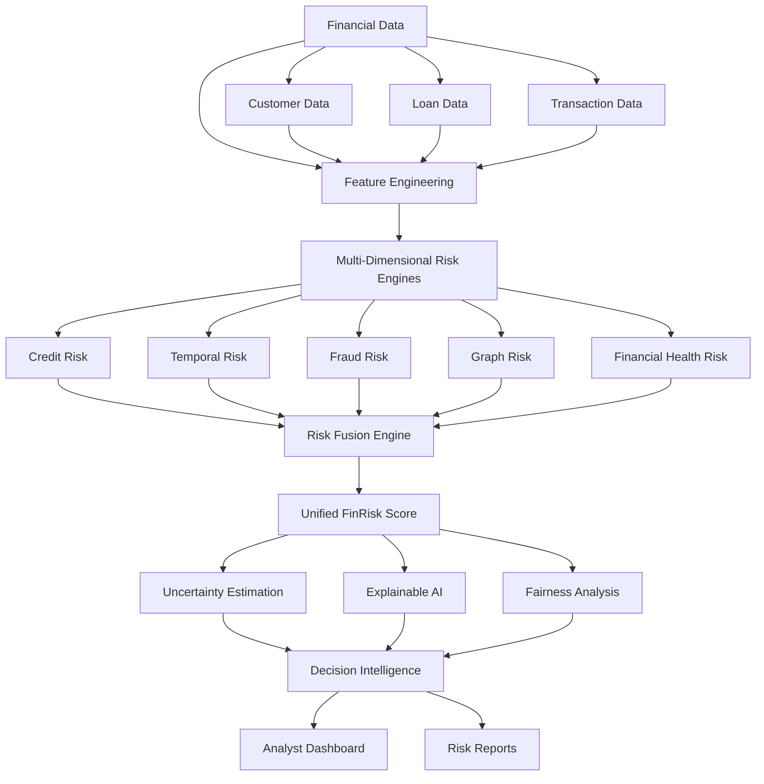

# FinRisk-X
Multi-Modal, Temporal and Explainable Financial Risk Intelligence Framework integrating credit risk, fraud detection, temporal analysis, graph-based risk, uncertainty estimation, fairness analysis and AI-driven decision intelligence.

# FinRisk-X

### A Multi-Modal, Temporal & Explainable Financial Risk Intelligence Framework

FinRisk-X is an integrated financial risk intelligence framework designed to analyze customer financial behaviour and identify multiple dimensions of financial risk through machine learning, temporal analysis, graph-based insights, uncertainty estimation, and explainable AI.

Rather than relying on a single credit-risk prediction, FinRisk-X combines multiple risk signals into a unified risk assessment framework. It also provides decision recommendations, confidence-aware human review, fairness analysis, and an interactive dashboard for exploring risk insights.

---

## Project Overview

Financial risk assessment involves more than evaluating a customer's credit history. Transaction behaviour, changing financial patterns, suspicious activities, and relationships between entities can provide additional signals that help identify potential risks.

FinRisk-X explores this problem through a multi-component architecture that integrates:

- Credit risk prediction
- Temporal financial risk analysis
- Fraud risk detection
- Graph-based risk analysis
- Financial health assessment
- Risk score fusion
- Uncertainty estimation and calibration
- Explainable AI using SHAP
- Fairness and bias analysis
- Decision intelligence and human-review recommendations

The framework consolidates these signals into a unified FinRisk score and presents the results through an interactive Streamlit dashboard.

## System Architecture



## Core Components

### 1. Credit Risk Prediction

The credit risk component evaluates customer and loan-related financial attributes to estimate credit risk.

Key elements:

- Customer financial profile analysis
- Feature engineering
- Machine learning-based prediction
- XGBoost-based credit risk model
- Risk score generation

Model artifact: `models/credit_risk_xgb.pkl`

### 2. Temporal Risk Analysis

Financial risk can change over time. The temporal component analyzes patterns in financial behaviour to identify changes that may indicate increasing financial stress or risk.

Key elements:

- Temporal feature analysis
- Behavioural pattern assessment
- Temporal risk modelling
- Risk score generation

Model artifact: `models/temporal_risk_model.pkl`

### 3. Fraud Detection

The fraud detection component combines supervised learning and anomaly detection to identify potentially suspicious transaction behaviour.

Key elements:

- Transaction feature engineering
- XGBoost-based fraud classification
- Isolation Forest-based anomaly detection
- Feature scaling and model preprocessing
- Fraud risk scoring

Model artifacts:

- `models/fraud_xgb_model.pkl`
- `models/fraud_isolation_forest.pkl`
- `models/fraud_scaler.pkl`
- `models/fraud_anomaly_scaler.pkl`

### 4. Graph-Based Risk Analysis

The graph risk component incorporates relationship-based risk signals to extend analysis beyond individual customer attributes.

It contributes a graph-based risk score to the overall risk assessment framework.

### 5. Risk Fusion Engine

The Risk Fusion Engine combines the individual risk components into one unified FinRisk score.

The implemented weighted scoring framework is:

| Risk Component        |   Weight |
| --------------------- | -------: |
| Credit Risk           |      30% |
| Temporal Risk         |      20% |
| Fraud Risk            |      25% |
| Graph Risk            |      15% |
| Financial Health Risk |      10% |
| **Total**             | **100%** |

The scoring formula is:

[
\begin{aligned}
FinRisk = (&0.30 \times CreditRisk)\\

- (&0.20 \times TemporalRisk)\\
- (&0.25 \times FraudRisk)\\
- (&0.15 \times GraphRisk)\\
- (&0.10 \times FinancialHealthRisk)
  \end{aligned}
  ]

The resulting score is constrained to a range of 0–100.

### 6. Explainable AI

FinRisk-X incorporates Explainable AI to make model outputs more interpretable.

SHAP (SHapley Additive exPlanations) is used to examine feature contributions and understand which variables influence model predictions.

This helps provide insight into:

- Important predictive features
- Individual prediction explanations
- Factors contributing to elevated risk
- Model behaviour and interpretability

### 7. Uncertainty Estimation and Calibration

A prediction should not be treated as equally reliable in every situation.

FinRisk-X incorporates probability calibration and uncertainty estimation to identify predictions that may require additional attention.

The uncertainty calculation used is:

[
Uncertainty = 1 - 2|P - 0.5|
]

Where (P) represents the calibrated probability.

Confidence is calculated as:

[
Confidence = 1 - Uncertainty
]

The framework uses an uncertainty threshold of 0.40 to flag cases for potential human review.

### 8. Fairness and Bias Analysis

The fairness component examines model outcomes across selected demographic and employment-related groups.

The analysis includes:

- Age-group analysis
- Employment-category analysis
- Risk distribution comparisons
- Disparity analysis

The purpose is to identify potential differences in model outcomes and support more responsible risk assessment.

### 9. Decision Intelligence

The Decision Intelligence component translates risk scores, uncertainty, and supporting explanations into actionable assessment categories.

The implemented decision categories include:

- Approve
- Enhanced Review
- Human Review
- Reject

The framework also generates supporting reasons, recommended actions, and confidence-related information to assist the assessment process.

These are model-generated recommendations, not automatic real-world financial decisions.

---

## Interactive Dashboard

FinRisk-X includes an interactive dashboard developed using Streamlit.

The dashboard is organised into six sections:

| Dashboard Section      | Purpose                                                  |
| ---------------------- | -------------------------------------------------------- |
| Executive Overview     | Overall risk distribution and key performance indicators |
| Customer Risk Explorer | Explore individual customer risk profiles                |
| Risk Intelligence      | Examine risk components and their contributions          |
| Uncertainty Analysis   | Review prediction uncertainty and confidence             |
| Decision Intelligence  | Explore decision categories and recommendations          |
| Fairness Analysis      | Examine age and employment-group disparities             |

The dashboard is designed to make the framework's outputs accessible through visual summaries and customer-level analysis.

---

## Technology Stack

| Category                | Technologies                |
| ----------------------- | --------------------------- |
| Programming Language    | Python                      |
| Data Processing         | Pandas, NumPy               |
| Machine Learning        | Scikit-learn, XGBoost       |
| Anomaly Detection       | Isolation Forest            |
| Explainable AI          | SHAP                        |
| Visualisation           | Plotly, Matplotlib, Seaborn |
| Dashboard               | Streamlit                   |
| Model Persistence       | Joblib / Pickle             |
| Development Environment | Jupyter Notebook            |

---

## Project Structure

```text
FinRisk-X/
│
├── app/
│   └── app.py
│
├── data/
│   ├── raw/
│   │   ├── customers.csv
│   │   ├── loans.csv
│   │   └── transactions.csv
│   │
│   └── processed/
│       ├── customer_financial_profile.csv
│       ├── enhanced_customer_profile.csv
│       ├── customer_graph_risk.csv
│       ├── final_risk_scores.csv
│       ├── final_risk_scores_explainable.csv
│       ├── final_risk_scores_uncertainty_aware.csv
│       ├── finrisk_decision_intelligence.csv
│       ├── finrisk_dashboard_data.csv
│       ├── finrisk_dashboard_kpis.csv
│       ├── dashboard_risk_distribution.csv
│       ├── dashboard_risk_components.csv
│       ├── fairness_age_analysis.csv
│       ├── fairness_employment_analysis.csv
│       ├── fairness_age_disparity.csv
│       └── fairness_employment_disparity.csv
│
├── models/
│   ├── credit_risk_xgb.pkl
│   ├── credit_risk_features.pkl
│   ├── temporal_risk_model.pkl
│   ├── fraud_xgb_model.pkl
│   ├── fraud_isolation_forest.pkl
│   ├── fraud_scaler.pkl
│   ├── fraud_anomaly_scaler.pkl
│   ├── fraud_feature_columns.pkl
│   └── risk_fusion_config.pkl
│
├── notebooks/
│   └── [Project development notebooks]
│
├── reports/
│   └── figures/
│       └── [Evaluation, explainability and analysis figures]
│
├── requirements.txt
├── .gitignore
└── README.md
```

*The tree describes the intended repository organisation. Keep only files that actually exist in your final project.*

---

## Installation and Setup

### 1. Clone the repository

```bash
git clone https://github.com/Harshal-satam/FinRisk-X.git
```

### 2. Navigate to the project directory

```bash
cd FinRisk-X
```

### 3. Create a virtual environment

```bash
python -m venv venv
```

Activate it on Windows:

```bash
venv\Scripts\activate
```

On macOS/Linux:

```bash
source venv/bin/activate
```

### 4. Install dependencies

```bash
pip install -r requirements.txt
```

### 5. Run the dashboard

```bash
python -m streamlit run app/app.py
```

Streamlit will provide a local URL in the terminal. Open that URL in your browser to access the dashboard.

**Important:** The dashboard depends on the processed datasets and model outputs being available in the expected project directories.

---

## Evaluation and Analysis

The project includes dedicated evaluation and analysis stages covering:

- Model performance evaluation
- Benchmarking
- High-risk customer analysis
- Uncertainty and confidence evaluation
- Human-review analysis
- Decision-category evaluation
- Explainability analysis
- Fairness and disparity assessment

Supporting analysis outputs and visualisations are organised in the `reports/` directory and processed data directories.

Actual numerical performance metrics should be reported alongside the corresponding evaluation methodology and dataset. They should not be interpreted as guarantees of real-world financial performance.

---

## Key Highlights

- Multi-dimensional financial risk assessment
- Integration of credit and fraud risk modelling
- Temporal and graph-based risk signals
- Weighted risk fusion framework
- Explainable predictions using SHAP
- Probability calibration and uncertainty estimation
- Human-review recommendations
- Fairness and disparity analysis
- Decision intelligence framework
- Interactive Streamlit dashboard

---

## Future Improvements

Potential extensions include:

- Real-time transaction monitoring
- Streaming data integration
- Advanced graph neural network models
- Model drift detection
- Automated model retraining
- More comprehensive fairness metrics
- Role-based analyst access
- API integration for external applications
- Cloud deployment and scalable infrastructure

---

## Responsible Use Disclaimer

FinRisk-X is an academic and portfolio-oriented machine learning project developed for research, experimentation, and demonstration purposes.

Its predictions, risk scores, and recommendations are not professional financial advice and should not be used as the sole basis for lending, credit approval, fraud accusations, or other consequential financial decisions.

Real-world deployment would require appropriate validation, representative data, privacy safeguards, security controls, regulatory review, and human oversight.

---

## Author

**Harshal Satam**

Computer Engineering | Artificial Intelligence | Data Science | Machine Learning

- GitHub: [Harshal-satam](https://github.com/Harshal-satam)
- LinkedIn: [Harshal Satam](https://www.linkedin.com/in/harshal-satam-487bb7248/)

---

*FinRisk-X — Bringing multiple dimensions of financial risk together through explainable and uncertainty-aware intelligence.*
